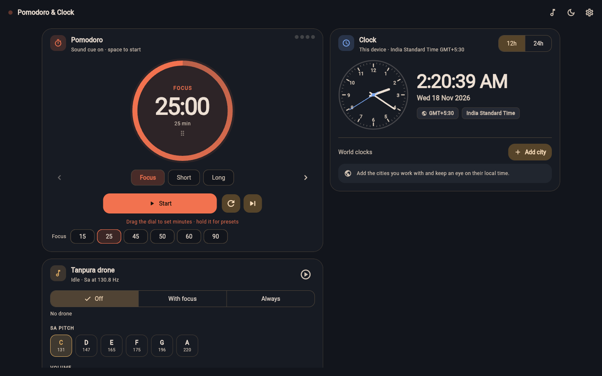
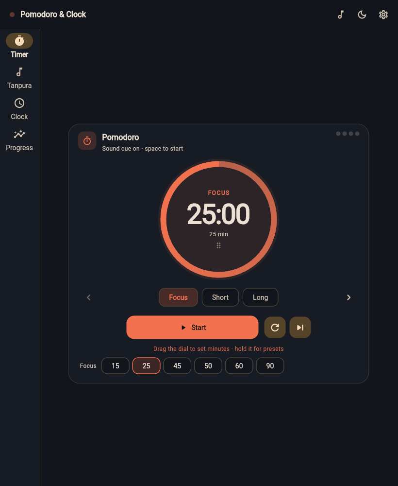
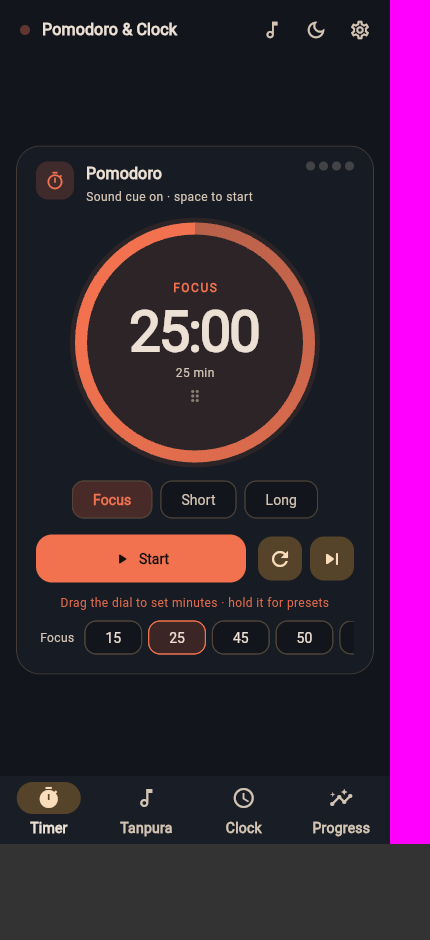
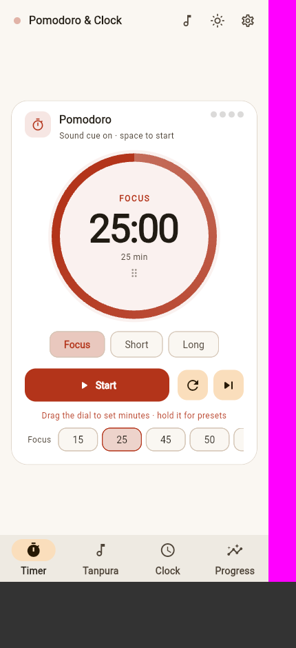
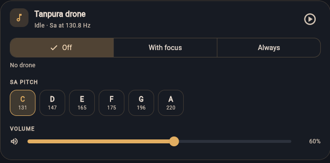

# Pomodoro & Clock

A focus timer and world clock built with Flutter, for **Windows**, **macOS**,
**Android**, **iOS** and the **browser**. One app, four shapes: a pomodoro timer
and real timezone-aware clocks side by side on a desktop, one panel at a time
behind a bottom bar on a phone, a held tanpura drone that can run under the
timer or entirely on its own. It keeps a practice journal that starts writing
when the timer does, and it can remind you to get back to it every 15 or 30
minutes — quietly, while a focus block is running.

The interface is Material 3, warmed with the tanpura's own amber-on-near-black
palette, and it re-lays itself for the window it is in.

| Desktop | Tablet | Phone | Phone, light |
| --- | --- | --- | --- |
|  |  |  |  |

## What it does

**Clock**

- Smooth-sweep analog face plus a large digital readout for this device.
- World clocks: add any city from the IANA database (search "berlin",
  "new york"), each with its own mini dial, wall time, UTC offset and
  abbreviation. Daylight saving is handled by the bundled timezone database,
  including a `+1d` badge when a city is on the next calendar day.
- 12h / 24h switch; the choice is remembered.

**Pomodoro**

- Focus / short break / long break cycle, defaulting to 25 / 5 / 15 with a long
  break every 4 blocks. All four numbers are configurable, plus quick presets
  (15 / 25 / 45 / 50 / 90 min).
- Countdown ring, cycle dots, Start / Pause / Reset / Skip, and direct phase
  tabs if you want to jump straight to a break.
- The ring is an instrument, not a picture of one: **drag it** to set the
  length (six pixels a minute, with a live "+7 min · 32 min" badge), **hold
  it** for the preset sheet, **swipe across** it to move Focus → Short → Long.
- Auto-start breaks and auto-start next focus are separate toggles.
- The countdown is anchored to the wall clock, not to tick counts, so closing
  the lid mid-block doesn't silently steal minutes. A phase that elapsed while
  the app was away resolves to exactly one completed block.
- A system alert sound plays when a phase ends (uses the OS sound, so it
  follows the machine's volume settings).

**Tanpura drone**

- A looping tanpura (the Indian held-drone instrument) that can sit under your
  focus blocks, or run by itself as a practice śruti.
- Three modes: **Off**, **With focus** (starts when a focus block starts, goes
  quiet for breaks and pauses), **Always** (a standalone drone box — the timer
  never touches it).
- Six sās to choose from (C D E F G A, 130.8–220 Hz), switchable while it is
  playing, plus a volume slider. The mode, pitch and volume all persist.
- The audio is generated, not downloaded, and the model is a *jawari* model
  rather than a generic plucked-string one. `scripts/make_tanpura.py` builds
  each of the four strings (Hindustani cycle: mandra Sa, Pa, then a unison
  Sa–Sa *jodi* pair detuned by ~6 cents for the slow beating) from 40–48
  inharmonic partials whose **sustain rises with frequency**, so the fundamental
  fades while the buzz cluster keeps ringing. Every string's decay constant is
  longer than the 2 s between plucks, which is the difference between a drone
  and an arpeggio. On top of that stack every
  partial is amplitude-modulated at a rate and depth that grow up the string —
  that one detail is what makes it read as a tanpura instead of an organ — plus
  tumba/tabli body formants, a fingernail click at each attack, and a gourd
  radiation rolloff that takes the fizz off the top. Stereo, with the four
  strings panned and two random-phase allpasses decorrelating the tails.
- Seamlessness is by construction, not by crossfade. Every frequency used —
  carriers, buzz rates, shimmer rates — is quantised to a multiple of 1/8 Hz,
  and each decay is the *periodic summation* of a single pluck's decay (closed
  form for exponentials), so one 8-second render is exactly one period of the
  steady-state drone: the loop point lands mid-rotation of the previous pluck's
  tail. A sustain longer than the cycle costs nothing. The plugin then loops it
  natively — sample-exact, no crossfade, no re-seek wobble.
- `scripts/check_tanpura.py` measures the result instead of trusting it, and
  gates on it: no step at the loop seam, no spectral leakage between bins, the
  buzz band present against the fundamental, real modulation depth at jawari
  rates, the level between plucks never collapsing, and the loudness checked on
  the **sustained body** rather than overall RMS. That last one matters: the
  first version of this checker passed a render whose wash was 7.6 dB *quieter*
  than the model it replaced, because four attack transients per cycle dominate
  an overall-RMS number. Loudness for a drone is measured over everything but
  the loudest decile of samples.

```powershell
python scripts/make_tanpura.py      # render all six sās (needs numpy)
python scripts/check_tanpura.py     # measure them; exits non-zero on a bad loop
```



**Stats**

- Sessions and focused minutes for today, the trailing 7 days, an active-day
  streak, and an all-time total, with a small weekly bar chart.
- History is stored per completed block, so changing durations never rewrites
  the past.

**Practice journal**

- The log starts writing the moment the timer does. Pressing Start opens a
  dated row — `Focus · running since 07:30` — with a field for what you are
  actually working on ("Ālāp in Yaman, second round"). Pausing closes the row
  at the time you really sat there; resuming opens a fresh one, so a
  half-finished pomodoro never claims minutes it did not get.
- Three kinds of entry, and the distinction is the useful one. **Sessions**
  occupy time (focus blocks, breaks, and **riyaz** — a sit-down with the
  tanpura and no timer at all, logged with one button, which is a first-class
  thing to do in this app). **Notes** are moments with no duration: a snag, a
  time to fix, a phrase that did not work.
- The timeline groups by day (`TODAY`, `YESTERDAY`, then dates), newest row
  first, so it opens on now and reads backwards. Tap any row to correct or
  delete it. "Copy the last 7 days" puts the whole week on the clipboard as
  plain text, ready for a notebook or a teacher.
- Minutes today count the timer *and* the riyaz, because both are practice.
- The store bounds itself: 500 rows and 1200 characters per row, oldest rows
  trimmed first, unreadable rows skipped rather than fatal. A row left open by
  a crash is closed at its own start time on the next launch, so it reads as
  the nothing-that-happened it was instead of growing all night.

**Interval reminders**

- A separate clock from the pomodoro one: every 10 / 15 / 20 / 30 / 45 / 60
  minutes (or off), nudge you back to whatever you said you were doing — for
  the days the timer isn't running and you still need pulling back.
- Four delivery channels, each with its own switch: the in-app banner, a
  chime, a real OS notification (Windows / macOS / Linux through
  `flutter_local_notifications`, the browser's Notification API on web), and a
  taskbar blink on Windows.
- The banner is a banner and not a snack bar: it stays until answered, because
  a reminder that times itself out is a reminder you never saw. Every answer is
  on the card — **Back to it**, **Later · 5 / 10 / 15 min**, **Quiet 30m** — and
  `Esc` answers it from the keyboard.
- **Held, not dropped, during focus.** If a focus block is counting when a
  reminder comes due, it waits for the block to end and then lands, so a
  25-minute ālāp isn't interrupted but the idle hour after it still gets its
  nudges. Breaks get no such protection, and the setting is one switch off.
- The reminder *lines* are yours to rewrite: a rotation of sentences, so the
  fourth nudge of the day does not read like the first, with the position in
  the rotation persisted. Add, edit and drop lines in the sheet; blank ones are
  skipped rather than shown.
- The cadence is driven by the app rather than the OS scheduler (the Windows
  plugin has no recurring-notification API), which keeps one clock for the
  banner, the chime and the toast — and means the app has to be running, even
  if minimized, for a reminder to fire.

Settings and history persist through `shared_preferences` — on Windows under
`%APPDATA%\com.pomodoro\pomodoro_clock\shared_preferences.json`, on macOS inside
the app's container, on Android in the app's private prefs, and in the browser's
`localStorage` on web. The practice journal lives in the same place, as one
bounded key.

## Design, layout and interaction

**Material 3, with one identity.** `lib/src/ui/theme.dart` seeds a standard MD3
`ColorScheme` from the tanpura's gold, then overrides the surface container ramp
so cards lift off a near-black ground instead of the usual grey-blue. On top of
the scheme sit three `ThemeExtension`s that the widgets are only allowed to
speak through:

- `PhasePalette` — the focus / break / drone accents, dark and light variants,
  with `lerp` so a phase change animates instead of snapping.
- `ShapeTokens` — card, control, pill and sheet radii.
- `MotionTokens` — the MD3 duration scale plus the emphasized decelerate /
  accelerate / standard curves, so everything in the app moves on the same clock.

Nothing in the UI hard-codes a colour or a radius any more, and that claim is
tested rather than asserted: `test/theme_contrast_test.dart` measures every text
pair against WCAG AA (4.5:1), every graphic pair against 3:1, the composited
card hairline against 1.4:1, and the card fill against the app background.

**Three window classes, one widget tree** (`AppBreakpoints`, MD3's own cut):

| Width | Shell | What you get |
| --- | --- | --- |
| < 600 | `NavigationBar` | one panel at a time, settings as a bottom sheet with the Save row pinned under the thumb, phase arrows dropped so the chips keep one line |
| 600–1000 | `NavigationRail` | the same panel, wider, with a divider |
| ≥ 1000 | none | two panes: timer + tanpura + stats beside the clock and the practice log. Nothing is hidden behind a tab, because on a desktop there is no reason it should be |

**Input follows the device.** Space starts and pauses, `R` resets, `S` skips,
`D` toggles the drone, `T` flips the theme, `J` opens the practice log, `1`/`2`/`3`
and `←`/`→` move between phases, `Esc` answers a reminder that is on screen, `?`
opens the shortcut sheet — all handled by a shell-level `Focus` with
`autofocus`, so a focused text field or button keeps its own keys (there is a
test for exactly that). The shortcut list is only advertised where a physical
keyboard exists. Touch devices get `Haptics` instead: selection ticks on chips
and swipes, a commit buzz when a drag sets a new length, and a heavier pattern
when a phase ends.

## Requirements

- [Flutter SDK](https://docs.flutter.dev/get-started/install) 3.24 or newer.
- **Windows:** Visual Studio 2019/2022 with the *Desktop development with C++*
  workload **and** a Windows 10/11 SDK. `flutter doctor` shows this as
  "Visual Studio - develop Windows apps". If it reports the installation is
  incomplete, run `scripts/install_windows_deps.ps1` (prompts for elevation).
- **macOS:** Xcode with command line tools **and** CocoaPods
  (`brew install cocoapods`) — `audioplayers_darwin` and `shared_preferences`
  are both CocoaPods dependencies. The macOS app must be built on a Mac.
- **Android:** Android SDK 36 with build-tools; `android/app/build.gradle.kts`
  pins the NDK version so the debug build stays reproducible. A debug APK needs
  roughly 2–3 GB of free disk for Gradle's caches.
- **Web:** any Chromium- or WebKit-based browser; `flutter build web` needs no
  extra toolchain beyond Flutter itself.

## Develop

```bash
flutter pub get
flutter run -d windows      # or: -d chrome, -d <android device id>
flutter analyze             # clean
flutter test                # 210 tests
```

## Build in the cloud, not on this laptop

`.github/workflows/build.yml` compiles every target on GitHub's runners: `check`
(format, analyse, test), `web`, `android` (per-ABI APKs + a bundle), and
`windows`, each uploading a named artifact. Ordinary pushes and pull requests
run only `check`; binaries are built on a `workflow_dispatch` or on a `v*` tag,
which also opens a GitHub Release with all four files attached.

This exists because a local cross-platform build costs this machine space it
does not have: the Gradle caches alone were ~500 MB, `build/` reached 380 MB,
and `windows/flutter/ephemeral` is 236 MB of downloaded engine that only the
compiler needs. The local workflow is therefore: edit, `flutter run -d chrome`
or `-d windows` for a quick look, push, download the artifact.

```powershell
gh auth login                                     # once, interactive
git init; git add -A; git commit -m "1.3.0"       # once
gh repo create pomodoro-clock --private --source=. --push
git tag v1.3.0; git push origin v1.3.0            # builds everything
gh run list                                       # watch it
```

Two things the workflow cannot do from here. iOS and macOS need an Apple
runner, which is not on the free tier — that is what Codemagic's hosted macOS
minutes are for. And Android release builds still sign with the debug key
(`android/app/build.gradle.kts`), so the APKs are sideloadable but not
publishable until a keystore is added as repository secrets.

## Build and install on Windows

```powershell
.\scripts\build_windows.ps1            # builds + writes dist\PomodoroClock-<ver>-windows-x64.zip
.\scripts\build_windows.ps1 -Install   # also copies to %LOCALAPPDATA%\Programs and adds a Start Menu entry
```

The zip is portable: it unpacks to one `PomodoroClock-<ver>-windows-x64`
folder — double-click `pomodoro_clock.exe` inside it. No installer, no
administrator rights, and nothing is written outside that folder except your
settings under `%APPDATA%`. Right-click the running taskbar icon to pin it.
Re-run with `-Install` to copy it to `%LOCALAPPDATA%\Programs` and get a Start
Menu entry instead.

## Build and install on macOS

```bash
./scripts/build_mac.sh          # release .app + drag-to-Applications .dmg in dist/
./scripts/build_mac.sh --no-dmg # .app only, zipped
```

The project was created on Windows, so `macos/Podfile` and the `.xcworkspace`
are not in the source archive — `flutter build macos` generates them on the
first run, along with the Pods for `shared_preferences` and `audioplayers_darwin`
(that's why CocoaPods is a requirement above). That's expected, not a broken
checkout.

Open the resulting `.dmg` and drag **Pomodoro Clock** to Applications. The script
ad-hoc signs the bundle so it launches on the machine that built it; for
distribution to other Macs, sign and notarize with your own Developer ID
(the command is commented in the script).

## Build for Android

```bash
flutter build apk --debug      # build/app/outputs/flutter-apk/app-debug.apk
flutter build apk --release    # signed with the debug key; wire it to your own
flutter install                # to a connected device
```

`android/` is a normal Flutter Android module (`minSdk 21`, `targetSdk 36`). The
drone plays through `audioplayers_android`, and the phase-end cue and the drag
commit use `HapticFeedback`, which is a no-op where there is no actuator.
Reminder alerts go through `flutter_local_notifications`; that plugin needs core
library desugaring enabled and the `POST_NOTIFICATIONS` permission declared, and
both are configured in `android/app/`. On Android 13 and newer the system asks
once, on the first reminder. This target has not been compiled or run on a
device from this workspace, so the mobile alert path is configured rather than
verified.

## Run in the browser

```bash
flutter build web --release
python -m http.server -d build/web 8080   # any static server will do
```

The web build is the same Dart UI, so it is the quickest way to check a layout
at a phone width. Audio needs a user gesture first (browser autoplay policy):
the drone stays silent until you press its play button, and the timer itself is
unaffected either way. Browser notifications are treated the same way — a tab
that asked on load gets them suppressed — so the reminder banner carries the one
**Allow** tap that asks for them, and until then a nudge reaches the screen and
the chime but not the notification centre.

## Release archives

`dist/` is local scratch — it is git-ignored, and the same files are published
as GitHub Releases by the `release` job when a `v*` tag is pushed. Everything
in it is generated by the scripts, so re-running them reproduces the artifacts:

| Archive | Made by | Contains |
| --- | --- | --- |
| `PomodoroClock-1.3.0-windows-x64.zip` (19 MB) | `scripts/build_windows.ps1` | Portable app folder: `pomodoro_clock.exe`, `flutter_windows.dll`, `audioplayers_windows_plugin.dll`, `flutter_local_notifications_windows.dll`, `data/` (incl. the six stereo tanpura WAVs, 1.4 MB each) |
| `PomodoroClock-1.3.0-source.zip` (9.1 MB) | `scripts/make_source_zip.ps1` | Full source (`lib`, `test`, `tool`, `assets`, `scripts`, `android`, `ios`, `windows`, `macos`, `web`, pubspec) — build it on any machine, including a Mac |
| `PomodoroClock-1.3.0-macos.dmg` | `scripts/build_mac.sh` (on macOS) | `.app` + `/Applications` alias — the script is ready, but no Mac has run it, so this artifact does not exist in `dist/` yet |

The Windows archive needs the Visual C++ ATL headers at *build* time —
`flutter_local_notifications`' Windows runner is C++/ATL — but nothing extra at
run time beyond the usual Flutter desktop DLLs it ships with.

iOS is built from the same source archive on a Mac:

```bash
cd ios && pod install && cd ..
flutter build ios --no-codesign     # or open ios/Runner.xcworkspace in Xcode
```

The macOS steps, including CocoaPods and the ad-hoc signing note, are under
**Build and install on macOS** above.

## Project layout

```
assets/audio/tanpura_{c,d,e,f,g,a}.wav   generated drone loops (8 s, stereo)
lib/
  main.dart                     entry point, provider + MaterialApp
  src/
    engine/pomodoro_engine.dart  pure state machine: phases, cycle, countdown
    models/pomodoro_config.dart  durations, toggles, JSON round trip
    models/tanpura_config.dart   drone mode, Sa pitch, volume, JSON round trip
    models/journal_entry.dart    log rows, day grouping, plain-text export
    models/nudge_config.dart     reminder cadence, delivery switches, prompts
    state/app_controller.dart    wall-clock anchoring, persistence, stats cache,
                                 journal capture, the reminder scheduler
    services/                    settings store, timezone lookups, sound cue,
                                 drone policy + player adapter (audioplayers),
                                 OS alerts (flutter_local_notifications) +
                                 the Windows taskbar blink, haptics
    stats/pomodoro_stats.dart    day bucketing, streaks, weekly buckets
    ui/
      theme.dart                 MD3 seed, surface ramp, PhasePalette / Shape /
                                 Motion extensions, SectionCard, MetaChip,
                                 breakpoints
      home_page.dart             the shell: NavigationBar / NavigationRail /
                                 two panes, the live app bar, the banner overlay
      pomodoro_card.dart         dial, drag + swipe + hold gestures, transport
      tanpura_card.dart          modes, sās, volume, breathing level bars
      clock_card.dart            face, digital readout, world clocks
      stats_card.dart            metrics and the weekly bars
      journal_card.dart          the log: open block field, notes, riyaz,
                                 day-grouped timeline, edit-a-row sheet
      nudge_banner.dart          the reminder card and its answers
      nudge_settings.dart        the Reminders block and the prompt editor
      duration_sheet.dart        hold-the-dial preset sheet
      keyboard_shortcuts.dart    key bindings and the "?" sheet
      settings_view.dart         one form, sheet or dialog by width
      zone_search_dialog.dart, analog_clock.dart, time_format.dart
android/ ios/ macos/ web/ windows/   platform runners
scripts/                        build_windows.ps1, build_mac.sh,
                                make_source_zip.ps1, install_windows_deps.ps1
                                make_tanpura.py  (render the loops),
                                check_tanpura.py (measure them; gates a release)
test/                           engine, controller, stats, timezone, drone
                                policy + wiring, journal model + capture,
                                reminder config + scheduler, theme contrast,
                                widget tests for every panel and both new
                                surfaces
tool/
  drone_probe.dart              hardware probe: drives the real audio plugin
                                (`flutter run -d windows -t tool/drone_probe.dart`)
  capture_window.ps1            screenshots the running Windows app, and refuses
                                to shoot if another window is above it
  make_shot_pages.py            iframe host pages so a headless browser can show
                                a true 390 px viewport
  make_seed_pages.py            the same pages with a week of practice written
                                straight into localStorage, so a screenshot can
                                show a populated log and a fired reminder
listen/                         the tanpura A/B render and its spectrum plot
```

The split is deliberate: `PomodoroEngine` has no timers, no IO and no Flutter
imports, so the cycle rules (including the awkward ones — skipping, sleeping
through a phase, midnight rollover) are covered by fast unit tests, and the UI
only ever reads a snapshot.

## Tests

```bash
flutter analyze      # clean
flutter test         # 210 tests
```

Coverage includes the phase machine (auto-start combinations, long-break
cadence, skip semantics), wall-clock anchoring in the controller, day/streak
bucketing in stats, DST-aware timezone labels, the drone policy truth table and
its wiring to every timer transition, the journal's minute math and JSON
round trip and the way the store bounds it, the reminder cadence including the
case where a focus block holds one and the case where a break does not, the
theme's measured contrast, and fifty widget tests that drive the real UI: all
three window classes down to 320 px without a single overflow, dial drags and
their ceilings, swipes and the one case where a swipe is refused, the
hold-for-presets sheet, every keyboard binding, the journal panel writing
itself when the ring starts, and a reminder banner that arrives, waits, and
answers `Esc`. The audio plugin itself is faked in tests —
`tool/drone_probe.dart` is what checks it against a real sound device — and so
is the notification centre: `test/support/fake_alerts.dart` records what would
have been delivered, so no test can ping a real machine.

## Notes and current limits

- Drone sound only; there is no tanpura app replacement for a live instrument.
  The loops are a physical model of a jawari bridge, not a recording of one: the
  attack is a synthesised click rather than a real nail-on-string, the gourd's
  response is a static formant set rather than a measured one, and a player's
  micro-timing (the slightly uneven four-beat cycle) is deliberately absent,
  because an uneven cycle cannot loop seamlessly. Re-generate with
  `python scripts/make_tanpura.py` (needs numpy) and then
  `python scripts/check_tanpura.py`, which fails the build if a render loses its
  buzz, dips to silence between plucks, or leaks at the seam.
- If the machine has no output device, the drone logs one line and stays quiet;
  the timer is deliberately unaffected either way, and there is a test for it.
- No system tray / menu bar item. Phase-end and reminder alerts now reach the
  OS notification centre (and the taskbar, on Windows), but they are fired by
  this process: quit the app and both the timer and the reminder cadence stop,
  because there is no background schedule behind it. The timer keeps running
  while the window is hidden or minimized.
- The window is a normal resizable window; there's no mini/always-on-top mode.
- Web is a first-class target now (`flutter build web` ships the same UI), but
  the browser can suspend a background tab, so a block that elapsed while the
  tab was asleep resolves through the same wall-clock anchoring the desktop uses
  — exactly one completed block, never a phantom streak of them.
- On phones the same anchoring is what saves a locked-screen session: there is no
  foreground service or live activity yet, so a phase that ends while the app is
  swiped away is settled when it next opens, and no OS notification warns you.
- `HapticFeedback` calls are the touch-device affordance; on Windows, macOS and
  web they are correctly no-ops, which is why the tests assert the calls rather
  than any feeling.
- The iOS runner is scaffolded and configured (`ios/`, `flutter build ios`), but
  nothing in this project has compiled it: that needs a Mac, and it has only been
  verified as far as `flutter analyze` and the widget tests go.
